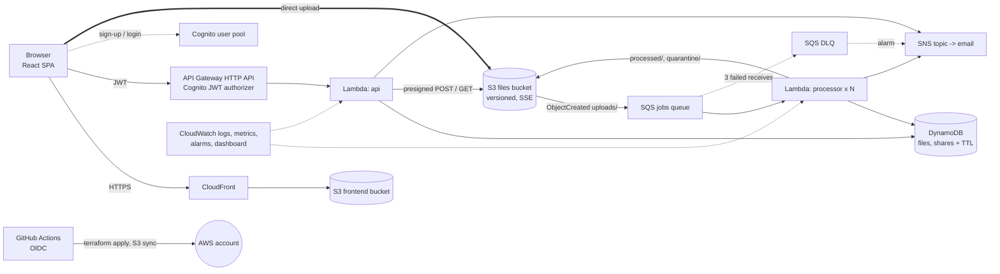

# CloudVault architecture

## Upload and processing flow
1. SPA calls `POST /files/upload-url` -> API records the file (`PENDING_UPLOAD`) and returns a presigned POST limited to the declared content type and 100 MB.
2. Browser uploads straight to S3 (no server in the data path).
3. S3 `ObjectCreated` under `uploads/` enqueues a message in SQS.
4. The processor Lambda (up to 10 concurrent, one file per invocation, 300 s timeout) streams the object once: SHA-256, magic-byte type detection, EICAR/executable rejection, text extraction for search, gzip copy. Optional thumbnail if the Pillow layer is attached.
5. DynamoDB status moves `PROCESSING -> DONE` (or `QUARANTINED`/`BLOCKED`). After 3 failed receives the message goes to the DLQ, the file becomes `FAILED`, an alarm fires and SNS emails the team.

## Sharing flow
`POST /files/{id}/share` creates a random 192-bit token with expiry (DynamoDB TTL), optional download cap and optional PBKDF2-hashed password. Public `POST /s/{token}/download` checks password, increments the counter with a conditional update (race-safe) and returns a 60-second presigned URL.

## Design decisions
| Decision | Why |
|---|---|
| Presigned POST direct to S3 | Scales with upload bursts, no API payload limit, size enforced by S3 policy |
| S3 -> SQS -> Lambda (not S3 -> Lambda) | Buffering, retries, DLQ, concurrency cap protects cost |
| Single-pass streaming | Constant memory for 100 MB files |
| DynamoDB on-demand | No idle cost, TTL for link expiry |
| HTTP API + JWT authorizer | Auth enforced before Lambda runs, cheaper than REST API |
| OIDC role for CI | No long-lived AWS keys in GitHub |

## Security notes
S3 buckets are fully private (public-access block, SSE-S3, versioning). The frontend bucket is private and reachable only via CloudFront (origin access control). IAM roles are per-function and scoped to their resources. CORS on the files bucket and API is limited to the CloudFront site (plus localhost for dev). Filenames are sanitised and keys are namespaced by the Cognito `sub`, so users cannot reach each other's objects. The deploy role in `bootstrap/` can only be assumed by workflows on the `main` branch of the configured repo, but it is still AdministratorAccess for convenience; tighten it for real use.
